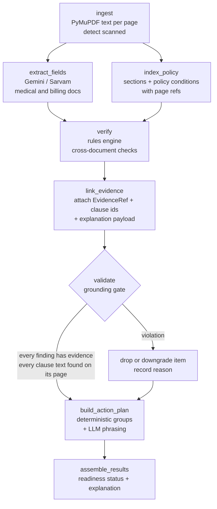

# Covara - Architecture, Modules and Division of Work

Team PineapplesOnPizza · Track 2: AI Powered Financial Journeys · Domain for the hackathon: **health insurance**
Companion to [PLAN.md](../PLAN.md) and the pitch deck (`Covara.pdf`). Phase 1 (skeleton) is already built.

> **Tagline / USP: "Evidence-linked claim readiness, not just claim assistance."**
> Every important finding must connect: **document evidence -> policy condition -> issue -> recommended action.**
> If a feature does not strengthen that chain, it is lower priority than anything that does.

---

## 1. What the deck promises (this is what the app must demonstrate)

| Deck item | What judges will expect to see |
|---|---|
| Smart Document Extraction | Upload policy, bills, prescriptions, reports -> structured fields appear, each with its source page |
| Cross-Document Verification | Missing documents, duplicate bills, inconsistencies (name, dates, amounts) detected across files |
| Policy Intelligence | Relevant clauses, coverage conditions, exclusions, limitations pulled from the uploaded policy |
| Intelligent Action Plan | Personalised, specific fixes tied to the user's actual issues (not generic chatbot text) |
| Claim Packet Generation | A submission-ready packet: verified documents + evidence references + structured claim summary |
| USP: traceable explanations | For any flag: *why was it flagged, what evidence, which clause, how to fix* |
| Tech stack | Next.js + Tailwind, FastAPI, Groq + Gemini, **LangGraph**, PostgreSQL/Supabase |

### Where the deck and PLAN.md disagree (decisions we are making)

| Topic | PLAN.md | Deck | Decision |
|---|---|---|---|
| Orchestration | Avoid orchestration infra | LangGraph | **Use LangGraph, thinly**: one linear/branching `StateGraph` whose nodes are plain, separately testable functions. No multi-agent behaviour. It gives stage-by-stage progress, partial-failure handling and matches the deck. |
| Database | In-memory is fine, Supabase optional | PostgreSQL/Supabase | **Repository interface now, in-memory implementation first**, Supabase as a stretch swap. Do not let it block the MVP. |
| Output | PDF report | "Claim packet" | **Two outputs**: (a) Readiness Report for the user, (b) Claim Packet for the insurer (summary + document index + evidence references + the originals merged). |
| LLM roles | Gemini main, Sarvam optional | Groq + Gemini | **Gemini** = multimodal/vision extraction and policy reading. **Groq** = fast text-only steps (action-plan phrasing) and fallback. **Sarvam Vision** = scanned/Indic documents, time-boxed. |

---

## 2. Architecture

### 2.1 System architecture

```
 +----------------------------------------------------------------------------------+
 |                               BROWSER - Next.js workspace                        |
 |  Landing -> Claim Workspace  [ Documents | Extracted data | Findings | Policy |    |
 |                                Action plan | Packet ]      + Evidence viewer       |
 +--------------------------------------+-------------------------------------------+
                                        |  REST / JSON  (CORS, polling for progress)
 +--------------------------------------v-------------------------------------------+
 |                               FASTAPI  (one router per module)                   |
 |  /claims  /documents  /extraction  /policy  /results  /evidence  /report /packet |
 +--------------------------------------+-------------------------------------------+
                                        | POST /analyze  (202, background job)
 +--------------------------------------v-------------------------------------------+
 |                    LANGGRAPH PIPELINE  (typed shared state: ClaimState)          |
 |                                                                                  |
 |   ingest -> +-- extract_fields -------+                                          |
 |             |                         +-> verify -> link_evidence -> validate -+  |
 |             +-- index_policy ---------+                                        |  |
 |                                                                                v  |
 |                                            build_action_plan -> assemble_results |
 +------+-------------------+-------------------+------------------+----------------+
        |                   |                   |                  |
 +------v------+   +--------v--------+   +------v-------+   +------v--------------+
 | Document    |   |   LLM GATEWAY   |   |  RULES       |   |  OUTPUT             |
 | processing  |   | Gemini (vision/ |   |  ENGINE      |   |  ReportLab report   |
 | PyMuPDF     |   |  extraction)    |   |  (pure       |   |  PyMuPDF packet     |
 | Sarvam      |   | Groq (text,     |   |  Python, no  |   |  merge + page       |
 | Vision      |   |  fallback)      |   |  LLM)        |   |  highlight render   |
 +------+------+   | schema-checked, |   +------+-------+   +------+--------------+
        |          | timeouts, retry |          |                  |
        |          +--------+--------+          |                  |
 +------v-------------------v-------------------v------------------v---------------+
 |  STORAGE:  Repository interface (in-memory now -> Supabase/Postgres later)       |
 |            File store  backend/uploads/<claim_id>/<doc_id>.<ext>                 |
 +----------------------------------------------------------------------------------+

  Rule of the house: AI interprets unstructured content and phrases explanations.
  Deterministic Python does every comparison, calculation and decision about "is there an issue".
  The LLM never decides eligibility, approval or rejection.
```

### 2.2 Pipeline (LangGraph) with failure handling



Failure rules: one bad document must **not** fail the run. The node marks that document `failed`, the pipeline continues, and the results list `documents_failed` so the UI says so honestly. No policy uploaded -> skip `index_policy`, emit a "policy missing" finding, still run the rest.

### 2.3 The USP chain (this is the product, build everything to produce it)

```
 DOCUMENT EVIDENCE                 RULE / POLICY CONDITION            ISSUE                    ACTION
 -----------------                 -----------------------            -----                    ------
 hospital_bill.pdf  p.2            Rule AMOUNT_BILL_VS_CLAIM          "Bill total differs      "Check the total on
 "Total payable  85,000"    --->   compared: 85,000 vs 95,000   --->   from the amount you  -> your claim form. If the
 (highlighted on page image)       (computed in Python, rule_id       entered"                 bill is right, correct
                                    recorded)                         severity: medium         the claimed amount to
 claim form  claimed_amount                                           kind: confirmed          85,000."
 "95,000"                          Policy clause  c-014                review: yes              [linked to finding f-003]
                                   policy.pdf p.7  "Room rent ...
                                   limited to 1% of sum insured"
                                   (text verified present on p.7)
```

Every arrow is data in the API, not prose. The UI "Why was this flagged?" panel renders this chain for any finding.

---

## 3. USP guard rails (hard invariants - enforced in code, tested, shown in the demo)

| # | Invariant | Enforced where | Deck USP it protects |
|---|---|---|---|
| I1 | **No finding without >=1 `EvidenceRef`** (document, page, quote or value). The pipeline gate removes or downgrades violators. | Pydantic validator + `validate` node | Traceable explanations |
| I2 | **No policy clause is shown unless its text is found on that page of that uploaded policy** (substring/fuzzy check against the page text). Otherwise: "No matching clause found in the uploaded policy." | `validate` node (grounding check) | Connects findings to clauses, no fabrication |
| I3 | **Every action carries `finding_ids` and names concrete values/documents** from that finding. No free-floating advice, no chat box. | Action schema + test | Personalised plans, not a chatbot |
| I4 | **Comparisons are made by Python.** Each finding stores `rule_id` and the compared inputs so the explanation is reproducible. | Rules engine | Cross-verification you can trust |
| I5 | **Two confidence classes**: `confirmed` (hard mismatch) vs `possible` (needs human review). Wording is "to review", never "fraud", "rejected" or "will be approved". | Rules engine + copy review | Responsible claims |
| I6 | **Unknown stays unknown.** Missing/low-confidence values are shown as such, never guessed. | Extraction schema | Honest extraction |
| I7 | Uploaded documents are untrusted input; instructions inside them are ignored. | LLM gateway prompts | Safety |
| I8 | Disclaimer present in UI, report and packet. Synthetic data only for demos. | Shared component/template | Safety |

---

## 4. Shared contract (agree and commit in Gate 0 - both people, ~45 min)

Everything else depends on this. Put it in `backend/app/schemas/` and mirror in `frontend/src/types/`.

```python
EvidenceRef      {document_id, filename, page_number, quote|None, value|None, bbox|None}   # I1 lives here
ExtractedField   {id, key, value|None, raw_text, confidence: high|medium|low|unknown,
                  evidence: EvidenceRef, user_corrected: bool}
PolicyClause     {id, topic, text, document_id, filename, page_number}                     # text must exist on page (I2)
Finding          {id, rule_id, issue_type, severity: low|medium|high, kind: confirmed|possible,
                  title, description, evidence: list[EvidenceRef],
                  extracted_value|None, comparison_value|None,
                  clause_ids: list[str], explanation: {rule, inputs, why_it_matters},
                  requires_human_review: bool, status: open|acknowledged|resolved}
Action           {id, group: upload|verify_or_correct|policy_review|consistent|ask_insurer,
                  text, finding_ids: list[str]}                                            # I3
AnalysisResults  {claim_id, status: processing|complete|failed, stage, progress,
                  readiness_status: ready|needs_attention|incomplete, readiness_explanation,
                  documents: [{id, status, error|None}], fields, findings, clauses,
                  policy_snapshot, action_plan, checklist, disclaimer}
```

**Key vocabulary for `ExtractedField.key`** (extend only by agreement):
`patient_name, policyholder_name, insurer, policy_number, policy_start, policy_end, sum_insured, room_rent_limit, waiting_period, hospital_name, admission_date, discharge_date, diagnosis, treatment, bill_number, bill_total, line_item, receipt_amount, receipt_date, referenced_document` (the last one = "this document mentions a prescription/report that should exist").

**Decisions to lock in Gate 0**

| # | Decision | Recommendation |
|---|---|---|
| D1 | Sync or async analysis | `POST /analyze` -> 202 + background task; `GET /results` returns `status/stage/progress`; UI polls every 2 s |
| D2 | Source of "claimed amount" | Add `claimed_amount` (+ optional `patient_name`) to the claim form and `ClaimCreate` |
| D3 | Readiness rule (code, not LLM) | `incomplete` if policy or final bill missing; else `needs_attention` if any open finding is medium+ or needs review; else `ready` |
| D4 | Required-document checklist | Policy, final bill, itemised bill, discharge summary, payment receipt required; prescription/diagnostic report required only if referenced |
| D5 | Packet wording | "Draft - N items need review" while open findings remain; "Prepared for submission" when none. Never "approved". |
| D6 | Model names / keys | Each person sets `GEMINI_MODEL`, `GROQ_MODEL` and keys in their own `backend/.env` |
| D7 | Code layout | Feature folders (below). Whoever does Gate 0 moves the Phase 1 files into it (mechanical). |

**Feature-based code layout** (each module = its own folder, so two people rarely touch the same file):

```
backend/app/
  schemas/                 # SHARED contract (change only via small, announced commits)
  core/                    # config, llm gateway, repository, providers
  modules/
    intake/  extraction/  verification/  policy/  evidence/  actions/  packet/  pipeline/
      router.py  service.py  tests/        # each module owns these
frontend/src/
  types/                   # SHARED contract mirror
  features/
    workspace/ intake/ extraction/ verification/ policy/ evidence/ actions/ packet/
      components/  api.ts  hooks/
sample_documents/          # scenarios + expected_results (owned by M9)
```

---

## 5. Modules (feature ownership - each module is full-stack: API + logic + UI + tests)

Estimates are rough working hours for the **MVP cut** only.

### M1 - Intake & Document Vault · *Person 1* · ~0.75 h
Deck: foundation for everything; "missing documents" starts here.
- **Backend:** add `claimed_amount` to `POST /claims`; `GET /claims/{id}/checklist` (required vs received, from D4); `GET /documents/{id}/file` (serve original for the evidence viewer); duplicate warning at upload (same `sha256` already in claim).
- **Frontend:** finish upload screen (claimed amount, category, status), **live completeness checklist** that updates as files arrive, duplicate warning.
- **Needs:** Phase 1 code. **Feeds:** M2, M3, M5, M7.
- **USP guard:** the checklist is deterministic and already shows "missing evidence" before any AI runs.
- **Done when:** uploading policy + bill ticks the checklist; unticked items are visible; original files can be fetched.

### M2 - Smart Document Extraction · *Person 1* · ~3.5 h
Deck: "Smart Document Extraction". Medical and billing documents only (policy is M4).
- **Backend:** `ingest` (PyMuPDF text per page, scanned/low-text detection, images straight to vision), LLM extraction -> `ExtractedField[]` with page + quote and confidence, `GET /claims/{id}/extraction`, `PATCH /claims/{id}/fields/{id}` (user correction -> `user_corrected=true`, re-run verification only).
- **Frontend:** "Extracted data" tab: table grouped by document -> field, value, confidence badge, source page link to the evidence viewer; inline edit.
- **Needs:** LLM gateway (M8), sample documents (M9). **Feeds:** M3, M5, M7.
- **USP guard (I6, I7):** unknown stays unknown; document text is treated as untrusted.
- **Stretch:** Sarvam Vision for scanned/Indic docs (**time-box 30-45 min**, only after clean PDFs work).
- **Done when:** the demo bill, discharge summary and receipt produce correct fields with page + quote (checked against `expected_results`).

### M3 - Cross-Document Verification · *Person 2* · ~2 h
Deck: "Cross-Document Verification" (missing docs, duplicate bills, inconsistencies).
- **Backend (`modules/verification`, pure Python, no network):** each rule has a `rule_id` and returns `Finding`s with evidence from **both** sides of the comparison:
  `NAME_MISMATCH` (normalised + fuzzy; "likely variation" = possible, clear mismatch = confirmed), `DATE_ORDER` (admission <= discharge), `TREATMENT_WITHIN_POLICY_PERIOD`, `AMOUNT_BILL_VS_CLAIM`, `LINE_ITEMS_VS_TOTAL`, `DUPLICATE_DOCUMENT` (sha256, same bill number/total), `MISSING_REQUIRED_DOCUMENT` (checklist), `REFERENCED_DOCUMENT_MISSING`, and `ROOM_RENT_VS_LIMIT` (uses `room_rent_limit` from M4).
- **Frontend:** "Findings" tab: list with severity, confirmed/possible badge, filters, counts; opens the evidence panel (M5).
- **Needs:** fields (fixtures first, then M2/M4). **Feeds:** M5, M6, M7.
- **USP guard (I4, I5):** rule_id + inputs stored; careful wording.
- **Done when:** the three planted demo issues are detected with correct evidence, and a clean claim yields no false alarms.

### M4 - Policy Intelligence · *Person 1* · ~2 h
Deck: "Policy Intelligence" (coverage conditions, exclusions, limitations).
- **Backend:** `index_policy`: split policy pages into sections, extract a **policy snapshot** (sum insured, room-rent limit, waiting periods, exclusions, sub-limits, required documents) each with page; keyword/topic retrieval `retrieve_clauses(topics)` -> `PolicyClause` with page; `GET /claims/{id}/policy`.
- **Frontend:** "Policy" tab: snapshot cards with page references; clauses highlighted when linked to a finding.
- **Needs:** ingest (M2/M8) and sample policy (M9). **Feeds:** M3 (`room_rent_limit`), M5 (clause links), M6, M7.
- **USP guard (I2):** a clause is stored only with its true page; if nothing matches, return "not found", never a guess.
- **Stretch:** rank exclusions/waiting periods against the extracted diagnosis; embeddings only if keyword retrieval is clearly failing.
- **Done when:** the demo policy yields a room-rent clause with the correct page and the snapshot matches `expected_results`.

### M5 - Evidence Linking & Explainability · *Person 2* · ~2.5 h  **(the USP module)**
Deck: "Traceable explanations", "connects findings directly to policy clauses".
- **Backend:** `link_evidence` (map each finding's `issue_type` to policy topics -> attach `clause_ids`, build `explanation{rule, inputs, why_it_matters}`); **`validate` grounding gate** enforcing I1 and I2; `GET /documents/{id}/pages/{n}/image?highlight=<quote>` (PyMuPDF renders the page and uses `search_for` to draw the highlight; falls back to the plain page if the quote cannot be located); `GET /claims/{id}/findings/{id}` detail.
- **Frontend:** the **Evidence viewer / "Why was this flagged?" panel**: left = highlighted document page, middle = policy clause with page, right = issue + recommended action. This is the screen for the demo.
- **Needs:** M3 findings, M2 quotes, M4 clauses (all fixture-first). **Feeds:** M6, M7.
- **USP guard:** owns I1-I3. Without this module the product is "just another extractor".
- **Done when:** for the demo finding you can click from the finding to the highlighted bill page and to the policy page text, and removing evidence from a test finding makes the gate reject it.

### M6 - Personalised Action Plan · *Person 1* · ~1 h
Deck: "Intelligent Action Plan".
- **Backend:** `build_action_plan(findings, clauses, fields, checklist)` -> grouped `Action[]`; groups are built deterministically, the LLM (Groq) only phrases text from the finding's own values; every action keeps `finding_ids` (I3). "Items that appear consistent" group lists checks that passed.
- **Frontend:** "Action plan" tab grouped by category, each action links back to its finding.
- **Needs:** M3, M4, M5. **Feeds:** M7.
- **Stretch:** mark finding acknowledged/resolved; upload a corrected document and re-analyse to watch the finding disappear.
- **Done when:** each demo finding has a specific action naming the real values/documents.

### M7 - Report & Claim Packet · *Person 2* · ~2 h
Deck: "Claim Packet Generation".
- **Backend:** `GET /claims/{id}/report` (ReportLab: the 9 sections in PLAN step 8). `GET /claims/{id}/packet`: **one merged PDF** (PyMuPDF): cover + structured claim summary -> document index with page ranges -> evidence-reference annex (finding -> file/page) -> referenced policy clauses -> original documents in checklist order (images converted to pages) with bookmarks -> disclaimer. Wording per D5.
- **Frontend:** "Packet" tab: readiness summary, what's included, download buttons, "N items still need review" notice.
- **Needs:** `AnalysisResults` (fixture first), files from M1. **Feeds:** the demo finish.
- **Done when:** both PDFs download, open correctly, and reflect the analysed claim.

### M8 - Pipeline & Platform · *Person 1* · ~1.5 h
- **Backend:** `modules/pipeline`: LangGraph `StateGraph` (section 2.2) with typed `ClaimState`; background job + in-memory job state + stage progress; **LLM gateway** (`core/llm`): Gemini schema-constrained calls, Pydantic validation, timeouts, retry/rate-limit handling, Groq fallback; `ClaimRepository` interface with an in-memory implementation; add `langgraph` to `requirements.txt`; no document content or PII in logs.
- **Frontend:** polling hook + progress component ("Reading documents -> Checking consistency -> Matching policy -> Building plan").
- **Needs:** contract. **Feeds:** everyone. **Build first** (as stubs) so others integrate early.
- **Stretch:** Supabase repository.
- **Done when:** `POST /analyze` on the demo set runs every stage and returns `complete`; killing a node leaves a partial result with an honest error.

### M9 - Workspace Shell, Demo Data & QA · *Person 2* · ~2.5 h
- **Demo data (do FIRST, M2 and M4 are blocked on it):** synthetic health policy (room-rent clause, waiting periods, exclusions), final bill, itemised bill, discharge summary that mentions a prescription that is **not** uploaded, payment receipt. Planted issues: bill total differs from `claimed_amount`; missing prescription; room-rent limit relevant to the bill. One scanned/image variant for Sarvam. `expected_results/*.json` with ground-truth fields and findings. Extra scenarios if time allows: clean claim, name variant, duplicate bill.
- **Shell:** landing page, `/claim/[id]` workspace with tabs/stepper, shared loading/error/empty states, disclaimer footer, responsive pass.
- **QA:** a script that runs the pipeline over each scenario and diffs `rule_id`s against `expected_results`; a 90-second demo script (section 8). Do not quote accuracy numbers unless measured.
- **Done when:** a teammate can run the whole demo from the README without help.

---

## 6. Ownership summary

| | **Person 1 - "Understand the documents"** | **Person 2 - "Prove the issues & deliver"** |
|---|---|---|
| Modules | M1 Intake, M2 Extraction, M4 Policy Intelligence, M6 Action Plan, M8 Pipeline & Platform | M3 Verification, M5 Evidence Linking (USP), M7 Report & Packet, M9 Shell, Demo Data & QA |
| Core skill | LLM/vision APIs, LangGraph, PDF parsing | Rules logic, PDF rendering, UI/UX, test data |
| MVP effort | ~8.75 h | ~9 h |
| Plus Gate 0 | 0.75 h | 0.75 h |

Honest note: ~19 h of MVP-cut work vs ~16 h available. That gap is why the plan is built as **thin vertical slices** (section 7) and has a cut list (section 9). Do not deepen any module until the end-to-end slice works.

**Who changes what (conflict avoidance):** each person edits only their modules' folders. Shared files: `backend/app/schemas/**`, `frontend/src/types/**`, `workspace` shell routes, `requirements.txt`, `package.json`. Edit them in small separate commits and tell the other person at once. One branch each; merge to `main` at every gate.

---

## 7. Dependencies, phases and build order

```
 Gate 0 contract ----+--> M9 demo data (minimum set) --------+--> M2 extraction --> M3 verification
        |            |                                       |         |                  |
        |            +--> M8 pipeline stubs + LLM gateway --+         +--> M4 policy ----+--> M5 evidence + gate
        |                                                                                      |
        +--> M9 shell + tabs on fixtures                                    M6 action plan <---+
                                                                                  |
                                                         M7 report + packet <-----+
```

Critical path: **contract -> demo data -> ingest/extract -> verify -> evidence link -> action plan -> packet.**
Anything not on this path (Sarvam, Supabase, resolve loop, translation) is optional.

### Phase overview

Numbering continues from PLAN.md (Phase 0 = environment, Phase 1 = skeleton, both **done**). Times are hours into the 8 h build. A phase is finished only when its **exit check** passes with both people looking at the same running app. Do not start deepening a later phase's work early.

| Phase | Name | Hours | Gate |
|---|---|---|---|
| 2 | Foundation: contract, layout, demo data | 0:00-0:45 | G0 |
| 3 | Walking skeleton: everything works on mock data | 0:45-2:15 | G1 |
| 4 | Real understanding: extraction and first real finding | 2:15-3:45 | G2 |
| 5 | Policy intelligence and the full USP chain | 3:45-5:15 | G3 |
| 6 | Action plan, report and claim packet | 5:15-6:30 | G4 |
| 7 | Hardening and QA | 6:30-7:00 | G5 |
| 8 | Freeze, polish, demo rehearsal | 7:00-8:00 | Demo-ready |
| 9 | Optional extras (only if everything above is green) | - | - |

**External dependencies (outside your control, sort these before Phase 2):**
Gemini API key + a valid `GEMINI_MODEL`; Groq API key + a valid `GROQ_MODEL` (check each provider's current docs for model names); Sarvam key (optional, only needed in Phase 7/9). Without the Gemini key, Phase 4 cannot start.

---

### Phase 2 - Foundation (0:00-0:45) · both people

| | Work |
|---|---|
| **Together (first ~30 min)** | Freeze the contract (section 4): schemas in `backend/app/schemas/`, TS mirror in `frontend/src/types/`, decisions D1-D7. Migrate Phase 1 code into the feature-folder layout. Add `claimed_amount` to the claim form/API. Add `langgraph` to `requirements.txt`. |
| **Person 1** | Verify keys: one working Gemini call and one Groq call through a minimal LLM gateway (`core/llm`). Pipeline package scaffold (M8). |
| **Person 2** | **Minimum demo set**: synthetic policy (with room-rent clause), final bill, discharge summary (mentions a prescription that is not uploaded) + a draft `expected_results`. Fixture `results.json` in the agreed schema. |

- **Depends on:** nothing inside the project. External: API keys and model names.
- **Blocks:** *everything.* Specifically Person 2's demo set blocks Phase 4 extraction and Phase 5 policy work; the contract blocks all parallel work.
- **Exit check (G0):** schemas committed on both sides and the 10 existing backend tests still pass after the migration; demo files and fixture exist; a Gemini and a Groq call each return a response.
- **USP check:** the `Finding` schema already requires `evidence` (I1) before anyone writes a rule.

### Phase 3 - Walking skeleton (0:45-2:15)

Goal: the **whole app works end to end on mock data**, so later phases only swap stubs for real logic.

| | Work |
|---|---|
| **Person 1** | **M8:** LangGraph pipeline with stub nodes that return the fixture; `POST /analyze` (202) and `GET /results` with `stage/progress`; polling hook + progress component. **M1:** checklist endpoint + live checklist UI, `GET /documents/{id}/file`, duplicate warning, `claimed_amount` input. |
| **Person 2** | **M9 shell:** landing + `/claim/[id]` workspace with all tabs (Documents, Extracted data, Findings, Policy, Action plan, Packet) rendering the fixture, shared loading/error/empty states, disclaimer footer. **M3:** rules engine on fixtures with unit tests (all rule_ids from section 5). |

- **Depends on:** Phase 2 contract + fixture. Handoffs inside the phase: Person 2's fixture `results.json` must be ready in the first ~20 min (Person 1's stubs return it); Person 1's polling hook/results API reaches Person 2 by ~1:15 (until then tabs import the fixture directly).
- **Blocks:** Phase 4 (real nodes replace stubs), Phase 5 (the evidence viewer needs the file endpoint from M1).
- **Exit check (G1):** upload -> analyze -> progress stages -> every tab shows mock data over real HTTP; checklist ticks as files upload; rules pass their unit tests on fixtures.
- **USP check:** the Findings tab already shows evidence for each mock finding.

### Phase 4 - Real understanding (2:15-3:45)

Goal: real documents in, real structured data and the **first real finding** out.

| | Work |
|---|---|
| **Person 1** | **M2:** `ingest` (PyMuPDF text per page, scanned detection) and Gemini extraction -> `ExtractedField[]` with page + quote + confidence; Extracted data tab bound to real data. Compare against `expected_results`. |
| **Person 2** | **M3:** run rules on **real** extracted fields as soon as Person 1's first output lands. **M5 groundwork:** `GET /documents/{id}/pages/{n}/image?highlight=` and the evidence viewer UI (page image with highlighted quote, fallback to plain page). |

- **Depends on:** Phase 2 demo set + working LLM gateway; Phase 3 file endpoint (M1) and the real-data pipeline hook. Handoff: Person 1's first correct fields (target ~3:00) unblock Person 2's real-data run; until then Person 2 keeps using fixtures.
- **Blocks:** Phase 5 (linking needs real findings with quotes). `ROOM_RENT_VS_LIMIT` waits for Phase 5 (needs M4).
- **Exit check (G2):** demo bill, discharge summary and receipt give correct fields with page + quote (checked against `expected_results`); the amount-mismatch finding appears from real data and opens a **highlighted bill page**.
- **USP check:** evidence quotes come from the document, not from the model's imagination (quote must exist in the page text).

### Phase 5 - Policy intelligence and the full USP chain (3:45-5:15)

Goal: complete **document evidence -> policy clause -> issue -> action** for the demo finding.

| | Work |
|---|---|
| **Person 1** | **M4:** `index_policy` (sections, policy snapshot: sum insured, room-rent limit, waiting periods, exclusions, required documents, each with page), topic retrieval -> `PolicyClause`, Policy tab real. |
| **Person 2** | **M5:** `link_evidence` (issue_type -> topic -> `clause_ids`, `explanation{rule, inputs, why_it_matters}`), **grounding gate** (I1, I2), "Why was this flagged?" panel with the clause. Add `ROOM_RENT_VS_LIMIT` once `room_rent_limit` exists. |

- **Depends on:** Phase 4 findings and quotes; Person 1's `PolicyClause` objects. Handoff: Person 2 develops linking against a fixture clause, then swaps in Person 1's real clauses at ~4:30.
- **Blocks:** Phase 6 (action plan needs findings + clauses; packet's clause annex needs them).
- **Exit check (G3):** for the demo finding you can click evidence page, then policy clause with correct page, then the explanation. Gate tests: a finding without evidence is rejected; a clause whose text is not on the stated page is dropped and the UI says "no matching clause found".
- **USP check:** this phase *is* the USP. If G3 fails, stop other work and fix it.

### Phase 6 - Action plan, report and claim packet (5:15-6:30)

| | Work |
|---|---|
| **Person 1** | **M6:** grouped, personalised action plan (deterministic groups; Groq phrases text from the finding's own values; every action keeps `finding_ids`). Action plan tab. **M2** inline field correction -> re-run verification only. **M8:** replace every remaining stub with the real node. |
| **Person 2** | **M7:** Readiness Report PDF (9 sections) and Claim Packet PDF (cover + summary, document index, evidence annex, clause annex, merged originals with bookmarks, wording per D5). Packet tab. |

- **Depends on:** Phase 5 for findings/clauses. Handoff: Person 2 builds both PDFs from the fixture first, then Person 1's `ActionPlan` lands (~6:00) and Person 2 wires it in. Packet also needs the stored originals from M1.
- **Blocks:** Phase 7 testing; the demo itself.
- **Exit check (G4):** real pipeline end to end on the demo set; both PDFs download and open correctly; every action cites a finding id; packet says "Draft - N items need review" while findings are open.
- **USP check:** I3 test: actions without `finding_ids` fail validation.

### Phase 7 - Hardening and QA (6:30-7:00)

| | Work |
|---|---|
| **Person 1** | Failure paths: bad/corrupt PDF, Gemini timeout/429/malformed JSON, one document failing while the rest continue; no document content or PII in logs; upload cleanup. Sarvam Vision (time-boxed 30-45 min) **only if G4 was green**. |
| **Person 2** | QA script running every scenario and diffing `rule_id`s with `expected_results`; **clean-claim run must produce no false alarms**; empty/error/loading states; copy review for I5 and I8 (no "fraud/rejected/approved"; disclaimer everywhere). |

- **Depends on:** Phase 6 complete.
- **Blocks:** Phase 8.
- **Exit check (G5):** all scenarios pass; a forced node failure yields a partial result with an honest message; no unresolved crash on bad input.

### Phase 8 - Freeze, polish and demo rehearsal (7:00-8:00)

- **Feature freeze at 7:00.** Bug fixes, responsive/visual polish, README update, two full rehearsals of the 90-second script (section 8), a backup screen recording/screenshots, and one known-good claim kept ready.
- **Exit check:** someone who did not build it can run the demo from the README.

### Phase 9 - Optional extras (only after Phase 8 is green)

Supabase repository, resolve/re-analyse loop, Sarvam translation, ranking exclusions by diagnosis, extra scenarios.

---

### Cross-person handoffs (the places you can block each other)

| # | Handoff | From -> To | Needed by | If late |
|---|---|---|---|---|
| H1 | Contract + decisions | both | Phase 2 end | Nothing else can start - do this first |
| H2 | Minimum demo documents | P2 -> P1 | Phase 2 end / Phase 4 start | P1 extracts from any public sample PDF meanwhile, but real tuning is blocked |
| H3 | Fixture `results.json` | P2 -> P1 | Phase 3 +0:20 | P1 writes a tiny fixture from the schema |
| H4 | Results API + polling hook | P1 -> P2 | Phase 3 +0:30 | P2 imports the fixture directly |
| H5 | File endpoint (`GET /documents/{id}/file`) | P1 -> P2 | Phase 4 start | P2 reads from `backend/uploads` in dev |
| H6 | First correct `ExtractedField`s | P1 -> P2 | ~3:00 | P2 keeps running rules on fixtures |
| H7 | Real `PolicyClause`s + `room_rent_limit` | P1 -> P2 | ~4:30 | P2 links against a fixture clause |
| H8 | `ActionPlan` | P1 -> P2 | ~6:00 | P2 renders the packet/report without the plan section, adds it later |
| H9 | Findings with evidence | P2 -> P1 | Phase 5 / 6 | P1 builds M6 on fixture findings |

If a handoff is late by more than ~20 minutes, the receiver switches to the fallback and carries on. Do not wait idle.

---

## 8. Demo path (the USP in 90 seconds)

1. Landing -> **Start a claim** (reimbursement, claimed amount 95,000).
2. Upload the demo set. The **checklist** shows what's present and what's missing (prescription flagged as *referenced but not uploaded*).
3. **Analyze.** Progress stages tick by (LangGraph).
4. **Extracted data:** fields with source page and confidence; fix one value by hand.
5. **Findings:** amount mismatch (confirmed), missing prescription, room-rent condition to review (possible).
6. Open the mismatch: **"Why was this flagged?"** -> highlighted bill page, the claim form value, rule used, linked policy clause on page 7, recommended action.
7. **Action plan:** grouped, specific, each linked to a finding.
8. **Download** the Readiness Report and the Claim Packet (shows "Draft - 3 items need review").

If steps 5-6 do not work end to end, nothing else matters. They are the product.

---

## 9. Cut list and risks

**Cut in this order when behind:** (1) Supabase, (2) resolve/re-analyse loop, (3) Sarvam Vision, (4) Groq fallback (keep for action-plan phrasing only if time), (5) extra scenarios beyond the three planted issues, (6) page-image highlighting (fall back to filename + page + quote text).
**Never cut:** upload -> extraction -> >=2 deterministic checks -> one grounded clause with page -> finding with evidence and action -> PDF download.

| Risk | Mitigation |
|---|---|
| Extraction gets a value wrong | Confidence badges, user correction (M2), grounding gate drops unsupported evidence |
| Quote can't be located for highlighting | Fall back to full page + quote text |
| LLM slow / rate limited / malformed JSON | Schema validation, retry, Groq fallback, partial results |
| Scope creep from the deck's business model slides | Business model/B2B2C is a pitch topic only; the API-first backend already supports it. Build none of it. |
| Demo data not ready in time | M9 minimum set is the first deliverable and unblocks M2/M4 |
| Over-promising | Copy says "items to review"; no approval/rejection prediction; no measured-accuracy claims without a measured test set |
