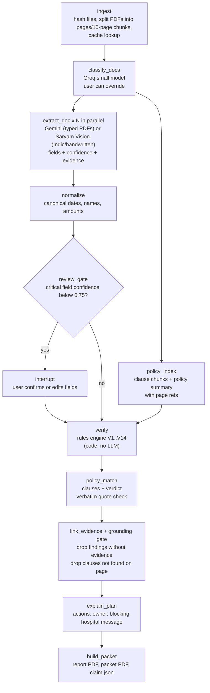

# Covara - How We Win, Architecture, Modules and Division of Work

Team PineapplesOnPizza · Track 2: AI Powered Financial Journeys · Hackathon domain: **health insurance** (property/travel = future scope)
Sources: [PLAN.md](../PLAN.md), the pitch deck (`Covara.pdf`) and the Build Guide (`Covara_Build_Guide.docx`). Phases 0-1 (environment + skeleton) are already **done**.

> **USP: "Evidence-linked claim readiness, not just claim assistance."**
> Every important finding connects: **document evidence -> policy condition -> issue -> recommended action.**

---

## 0. How we win (read this first)

Judges will weigh three things: **novelty**, a **visible USP**, and **end-to-end execution**. A flawless, honest, end-to-end demo of a smaller feature set beats a half-working large one.

**What most competing "claim assistant" projects will be:** a chatbot over a policy PDF, or an extractor that prints fields. We are different because:
1. every flag is **traceable** (click -> highlighted source page + policy clause + rule used),
2. problems are found **before submission** by deterministic cross-document checks, with **rupee impact** where possible,
3. the output is an **action plan with owners and a ready-to-send message**, and a **claim packet** that visibly goes from "INCOMPLETE" to "ready" after the user fixes things.

### 0.1 The "Wow set" - differentiators, in the order we add them (after Core works)

| # | Differentiator | Why it is novel / convincing | Cost | Module | Added in |
|---|---|---|---|---|---|
| W1 | **Demo safety net**: cache every LLM/OCR result by file hash, "demo mode" replays cache, one-click reset | Protects the demo from API/rate-limit/Wi-Fi failures. Losing the live demo loses everything | S | M8, M9 | Phase 3 |
| W2 | **Proportionate-deduction exposure (V10)**: if the room rent exceeds the policy cap, estimate the ₹ impact on related charges, tied to the clause | Turns "a clause exists" into "this could cost you about ₹X". Concrete, India-specific, memorable. Shown as *exposure to review*, never a decision | S-M | M3, M4 | Phase 5 |
| W3 | **Waiting-period / pre-existing conflict (V11)**: policy start vs diagnosis date vs waiting-period clause | High-value check; the clause citation is the "aha" | S | M3, M4 | Phase 5 |
| W4 | **Re-check loop (before/after)**: fix a bill or confirm a field, press Re-check, finding disappears, packet flips from "INCOMPLETE - 2 blocking items" to "Prepared for submission" | The best end-to-end story in 90 seconds. Cheap because of caching | S-M | M8, M6, M7 | Phase 6 |
| W5 | **Indian-language / handwritten document via Sarvam Vision** (one Hindi or Telugu bill or a handwritten prescription), output cached | India-first differentiation in an AI-financial-journeys track; uses a provider generic tools do not | M (time-boxed) | M2 | Phase 7 |
| W6 | **`claim.json` export** shaped so it can later map to an NHCX-style FHIR bundle | Credible scale/interoperability story for ~15 minutes of work | S | M7 | Phase 6 |
| W7 | **Privacy as a feature**: consent checkbox before upload, "delete my data" button, no document text in logs | Health data is sensitive; judges notice. Cheap | S | M1, M8 | Phase 3 |
| W8 | **Human review gate**: low-confidence critical fields (< 0.75) pause the run until the user confirms them | Honest-AI story ("we ask when unsure") and a real LangGraph `interrupt` | M | M2, M8 | Phase 7 |
| W9 | **Billed-but-not-prescribed items (V8)** | Strong cross-document check | M | M3 | Phase 9 |
| W10 | **Insurer/TPA completeness view** (read-only table of claims with readiness + blockers, same engine) | The B2B2C scale story from the deck, nearly free once data exists | M | M9 | Phase 9 |
| W11 | Explanations in Hindi/Telugu (Sarvam Translate, keeping numbers/clause IDs untranslated) | Language access | M | M6 | Phase 9 |

Core (the end-to-end path and the USP chain) must be finished before W2-W11. W1 and W7 are small and go in early on purpose.

### 0.2 Positioning (judges will ask)

> **"If insurers must collect documents from hospitals, why does the policyholder need Covara?"**
> 1. **Reimbursement claims still depend on the policyholder's own paperwork**, so readiness before submission matters.
> 2. Covara **explains policy conditions** (room-rent cap, waiting periods, exclusions) which cashless rules do not.
> 3. **B2B2C:** the same engine sells to insurers, TPAs and hospitals for completeness checks and rejection prevention.
> 4. **NHCX adoption is still uneven**, so PDF-based workflows persist. We keep our internal model mappable to NHCX-style data.

- **Hero scenario in the demo: reimbursement readiness.** Insurer/TPA mode is the scale story (W10).
- The Build Guide's regulatory points (IRDAI circulars, DPDP timelines) come partly from press coverage. **Verify against primary sources before quoting numbers on stage**; do not cite settlement-day or interest rules unless verified. This is engineering guidance, not legal advice.

### 0.3 Credibility rule
Do not quote accuracy, time-saved or cost figures unless **measured** on our test set. The QA script (M9) reports e.g. "caught N of M planted defects across 3 claims"; that sentence is allowed, invented percentages are not. Always show disclaimers: AI-assisted preparation, not an insurer decision, not medical/legal advice. Never use real patient data.

---

## 1. What the deck promises, and decisions where our sources differ

| Deck capability | Judges expect to see | Pipeline stage |
|---|---|---|
| Smart Document Extraction | Fields from policy, bills, prescriptions, reports, each with its source page | `classify_docs`, `extract_doc`, `normalize` |
| Cross-Document Verification | Missing docs, duplicate bills, inconsistencies (name, dates, amounts) | `verify` |
| Policy Intelligence | Relevant clauses, conditions, exclusions, limits from the uploaded policy, with page | `policy_index`, `policy_match` |
| Intelligent Action Plan | Specific fixes tied to the user's issues, with owners; not chatbot text | `explain_plan` |
| Claim Packet Generation | Summary + verified documents + evidence references in one packet | `build_packet` |
| USP: traceable explanations | Why flagged, which evidence, which clause, how to fix | `link_evidence` + grounding gate |

| Topic | PLAN.md | Deck / Build Guide | **Decision** |
|---|---|---|---|
| Orchestration | Avoid heavy orchestration | LangGraph + Postgres checkpointer + human-review interrupt | **LangGraph, thin.** Nodes are plain testable functions. **In-memory checkpointer** for the MVP (Postgres checkpointer is post-hackathon). Use `interrupt()` for the review gate (W8). LangGraph re-runs a node from its start on resume, so side effects must be idempotent and `interrupt()` is called once per node. |
| Database | In-memory fine | Supabase Postgres + pgvector, RLS, auth | **Repository interface, in-memory first.** No auth/RLS/pgvector for the hackathon. Supabase is a stretch swap. |
| Policy retrieval | Keyword/section first | Clause chunking + pgvector hybrid | **Clause-level chunking** (by numbered heading: clause ID, title, page, type) + keyword/type filter. Embeddings only if keyword retrieval visibly fails. |
| Packet | PDF report | Cover summary + merged docs + `claim.json` | Report **and** packet. Stay with **ReportLab + PyMuPDF** (no WeasyPrint: system-library risk). Add `claim.json`. |
| Progress | Poll | SSE | **Polling** for the MVP (more robust). SSE is optional later. |
| Sarvam | Optional, time-boxed | Core for Indic/handwritten OCR | **Targeted**: one Indic/handwritten demo document via `doc_ai`, with its output cached (W5). The installed SDK (`sarvamai`) exposes `doc_ai`; confirm the exact call signature in the SDK docs. |
| Document type | User picks category | `classify_docs` node | **Auto-classify with Groq, user can override** (category picker stays as fallback). |

---

## 2. Architecture

### 2.1 System architecture

```
 +---------------------------------------------------------------------------------+
 |                         BROWSER  -  Next.js workspace                           |
 |  Landing -> Claim workspace tabs:                                               |
 |  Documents | Review | Findings | Policy | Action plan | Packet                    |
 |  + Evidence viewer (highlighted page + clause)   + Consent / Delete my data      |
 +------------------------------------+--------------------------------------------+
                                      |  REST/JSON (CORS), polling for progress
 +------------------------------------v--------------------------------------------+
 |  FASTAPI - one router per module                                                |
 |  /claims  /documents  /review  /results  /evidence  /report  /packet           |
 +------------------------------------+--------------------------------------------+
                  POST /analyze (202) |  POST /review (resume after interrupt)
 +------------------------------------v--------------------------------------------+
 |  LANGGRAPH PIPELINE   typed ClaimState - in-memory checkpointer                  |
 |                                                                                 |
 |  ingest -> classify_docs -> +-> extract_doc (xN, parallel) -> normalize ->       |
 |                             |                                  review_gate       |
 |                             +-> policy_index ------------------------+ (pause)   |
 |                                                                      v           |
 |  verify -> policy_match -> link_evidence -> grounding gate -> explain_plan       |
 |                                                              -> build_packet     |
 +-----+------------------+-------------------+----------------------+-------------+
       |                  |                   |                      |
 +-----v--------+  +------v--------+  +-------v---------+  +---------v------------+
 | PROVIDER     |  | RULES ENGINE  |  | OUTPUT          |  | CACHE + CALL LOG     |
 | ADAPTERS     |  | V1..V14       |  | ReportLab report|  | key = sha256+task+   |
 | OCRClient:   |  | pure Python,  |  | PyMuPDF packet  |  |   model+prompt ver.  |
 |  Sarvam Vis. |  | NO LLM, each  |  | claim.json      |  | llm_calls: provider, |
 |  or Gemini   |  | rule has id + |  | page-highlight  |  |  model, task, tokens,|
 | LLMClient:   |  | stored inputs |  | image renderer  |  |  latency, error      |
 |  Gemini/Groq |  +---------------+  +-----------------+  | (never doc text)     |
 | retries,     |                                           +----------------------+
 | timeouts,    |
 | rate limits  |
 +-----+--------+
       |
 +-----v----------------------------------------------------------------------------+
 | STORAGE  Repository interface (in-memory now -> Supabase later)                  |
 |          Files: backend/uploads/<claim_id>/<doc_id>.<ext>  (deleted on request)  |
 +----------------------------------------------------------------------------------+

 House rule: AI READS and EXPLAINS. Deterministic Python DECIDES whether there is an issue
 (duplicates, totals, dates, required documents). The LLM never decides eligibility.
```

### 2.2 Pipeline (LangGraph)



Failure rules: one bad document never fails the run (mark it `failed`, continue, report `documents_failed`). No policy uploaded -> skip `policy_index`, emit a "policy missing" finding, run the rest. A provider failing -> fall back (Section 2.4) or flag for human review.

### 2.3 The USP chain (this is the product; every module exists to produce it)

```
 DOCUMENT EVIDENCE                 RULE / POLICY CONDITION            ISSUE                    ACTION
 -----------------                 -----------------------            -----                    ------
 hospital_bill.pdf  p.2            Rule V4 (totals)                    "Bill total differs      "Check the total on your
 "Total payable  85,000"    --->   compared: 85,000 vs 95,000   --->  from the amount you ---> claim form. If the bill
 (highlighted on page image)       (computed in Python, inputs        entered"                 is right, correct the claimed
 claim form claimed_amount          stored with the rule id)          severity: medium         amount to 85,000."
 "95,000"                                                             kind: confirmed          Owner: you  · Blocking: yes
                                   Policy clause 4.2  (p.7)           review: yes              [linked to finding f-003]
 hospital_bill.pdf  p.1            "Room rent ... limited to 1%       "Room rent exceeds cap:  "Ask the insurer whether
 "Room rent  5,000 / day"   --->   of sum insured per day" --->       estimated exposure       proportionate deduction
                                   verdict: may apply · quote         about ₹X to review"      applies. Draft message ready."
                                   verified verbatim on p.7
```

Every arrow is data in the API, not prose. The UI "Why was this flagged?" panel renders this chain for any finding.

### 2.4 Model routing and provider facts (from the Build Guide; verify current docs)

| Task | Primary | Fallback | Notes |
|---|---|---|---|
| Document-type classification | Groq (small model) | Gemini Flash-class | Short input only |
| OCR: Indic / handwritten / scanned | Sarvam Vision (`doc_ai`) | Gemini PDF input | Cross-check low-confidence pages |
| Typed English bills/reports | Gemini with response schema | Sarvam Vision then LLM | Direct PDF-to-JSON |
| Policy chunking + matching | Gemini (long context) | Sarvam-105B (optional) | Needs the whole policy in view |
| Fuzzy clinical checks (V8/V9) | Gemini | - | Only with structured inputs |
| Action-plan phrasing | Groq or Gemini | the other | Input = structured findings + clauses only, never raw documents |
| Regional-language explanation (W11) | Sarvam Translate | Gemini | Keep numbers/dates/clause IDs from structured data |

| Provider limit (per Build Guide, confirm in consoles) | Consequence for design |
|---|---|
| Sarvam Vision: max 10 pages per job, 10 requests/min | Split PDFs into 10-page chunks, put a rate limiter in front, **cache by file hash** |
| Groq free tier: small token limits | Never send long documents or whole policies to Groq; router only |
| Gemini: Files API for large PDFs; **model names change** | Read `GEMINI_MODEL` from env; never hard-code |
| All providers | Check data-retention/training terms for the tier used before uploading anything real |

---

## 3. USP guard rails (hard invariants - enforced in code, tested, visible in the demo)

| # | Invariant | Enforced where |
|---|---|---|
| I1 | **No finding without >=1 `EvidenceRef`** (document, page, quote or value). | Pydantic validator + grounding gate |
| I2 | **No policy clause is shown unless its text is found on that page of the uploaded policy.** Otherwise: "No matching clause found in the uploaded policy." | Grounding gate |
| I3 | **Every action carries `finding_ids` and names concrete values/documents** from that finding. No chatbot box. | Action schema + test |
| I4 | **Comparisons are made by Python.** Each finding stores `rule_id` and its compared inputs. | Rules engine |
| I5 | Two classes: `confirmed` (hard mismatch) vs `possible` (needs review). Wording is "to review", never "fraud", "rejected" or "will be approved". Exposure amounts are labelled estimates. | Rules engine + copy review |
| I6 | **Unknown stays unknown.** Confidence is a number; low-confidence critical fields go to review, not silently into the packet. | Extraction schema + review gate |
| I7 | Uploaded documents are untrusted input; instructions inside them are ignored. | LLM prompts + tests |
| I8 | Disclaimer present in UI, report and packet. Synthetic data only for demos. | Shared component/template |
| I9 | **LLM clause verdicts** (`applies / may apply / does not apply`) must carry a **verbatim quote that exists in the retrieved text**; otherwise rejected. LLM calls use temperature 0 and one corrective retry on schema failure. | `policy_match` + gate |
| I10 | **Privacy:** consent captured before upload, `DELETE /claims/{id}` removes files and derived data, logs never contain document text or identifiers. | M1, M8 |

---

## 4. Shared contract (commit in Gate 0 - both people, ~45 min)

Put it in `backend/app/schemas/` and mirror in `frontend/src/types/`. Everything else depends on this.

```python
EvidenceRef      {document_id, filename, page_number, bbox: [x0,y0,x1,y1] normalised 0-1 | None,
                  quote: str | None}                                         # I1 lives here
ExtractedField   {id, key, value|None, raw_text, confidence: float 0-1, evidence: EvidenceRef,
                  user_confirmed: bool}                                      # review gate threshold 0.75
PolicyClause     {id, clause_ref, type: coverage|exclusion|sublimit|waiting_period|condition|definition,
                  title, text, document_id, filename, page_number}           # text must exist on page (I2)
PolicySummary    {sum_insured, room_rent_cap, copay, waiting_periods[], exclusions[],
                  pre_hosp_days, post_hosp_days}  # each value carries an EvidenceRef; used by rules V10/V11
Finding          {id, rule_id: "V1".."V14" (see M3 catalogue), issue_type, severity: low|medium|high,
                  kind: confirmed|possible, title, description, evidence: list[EvidenceRef],
                  extracted_value|None, comparison_value|None,
                  clause_links: list[{clause_id, verdict: applies|may_apply|does_not_apply, quote}],
                  exposure_amount|None,            # INR, informational estimate only
                  blocking: bool, explanation: {rule, inputs, why_it_matters},
                  requires_human_review: bool, status: open|acknowledged|resolved}
Action           {id, title, why, how, owner: user|hospital|doctor|insurer, blocking: bool,
                  group: upload|verify_or_correct|policy_review|consistent|ask_insurer,
                  finding_ids: list[str], clause_ids: list[str], draft_message|None, done: bool}   # I3
AnalysisResults  {claim_id, status: processing|awaiting_review|complete|failed, stage, progress,
                  readiness_status: ready|needs_attention|incomplete, readiness_explanation,
                  documents: [{id, doc_type, status, error|None}], fields, findings, clauses,
                  policy_summary, action_plan, checklist, packet_status, disclaimer}
```

**Key vocabulary for `ExtractedField.key`** (extend only by agreement):
`patient_name, age, policyholder_name, member_id, insurer, policy_number, policy_start, policy_end, sum_insured, room_rent_cap, room_rent_charged_per_day, waiting_period, hospital_name, admission_date, discharge_date, diagnosis, diagnosis_date, treatment, bill_number, bill_date, bill_total, line_item, billed_item, prescribed_item, receipt_amount, receipt_date, referenced_document`.

**Decisions to lock in Gate 0**

| # | Decision | Recommendation |
|---|---|---|
| D1 | Sync or async analysis | `POST /analyze` -> 202 + background task; `GET /results` returns `status/stage/progress`; UI polls every 2 s. SSE optional later. |
| D2 | Source of claimed amount | `claimed_amount` (+ optional `patient_name`) on the claim form and `ClaimCreate` |
| D3 | Readiness rule (code, not LLM) | `incomplete` if policy or final bill missing; else `needs_attention` if any open finding is `blocking` or medium+; else `ready` |
| D4 | Required-document checklist | Policy, final bill, itemised bill, discharge summary, payment receipt required; prescription/diagnostic report required only if referenced |
| D5 | Packet wording | While any `blocking` finding is open: watermark **"INCOMPLETE - N blocking items"**. When none: **"Prepared for submission"**. Never "approved". |
| D6 | Model names / keys | Each person sets `GEMINI_MODEL`, `GROQ_MODEL` and keys in their own `backend/.env` (never committed) |
| D7 | Code layout | Feature folders (below). Whoever does Gate 0 moves the Phase 1 files into it (mechanical). |
| D8 | Confidence and review | `confidence` is a float; critical fields (names, dates, amounts, IDs) below **0.75** trigger the review gate once W8 exists; before that they are shown with a "low confidence" badge. |
| D9 | Caching | Cache key = `sha256(file) + task + model + prompt_version`, stored on disk under `backend/.cache/` (git-ignored). "Demo mode" replays cache. Prompts are versioned constants. |
| D10 | Tiers | **Core / Wow / Stretch** as defined in sections 0.1 and 5. |

**Feature-based code layout** (each module = its own folder, so two people rarely touch the same file):

```
backend/app/
  schemas/                 # SHARED contract (change only via small, announced commits)
  core/                    # config, provider adapters (LLMClient, OCRClient), cache, call log, repository
  modules/
    intake/  extraction/  verification/  policy/  evidence/  actions/  packet/  pipeline/
      router.py  service.py  tests/
frontend/src/
  types/                   # SHARED contract mirror
  features/
    workspace/ intake/ extraction/ verification/ policy/ evidence/ actions/ packet/
      components/  api.ts  hooks/
sample_documents/          # scenarios + expected_results (owned by M9)
```

---

## 5. Modules (feature ownership - each is full-stack: API + logic + UI + tests)

Tags: **[Core]** = needed for the end-to-end USP demo · **[Wow]** = differentiator from section 0.1 · **[Stretch]** = only if everything is green. Hours are rough, Core only.

### M1 - Intake & Document Vault · *Person 1* · ~0.75 h Core
- **[Core]** `claimed_amount` on `POST /claims`; `GET /claims/{id}/checklist` (required vs received, D4); `GET /documents/{id}/file` (original, for the evidence viewer); duplicate warning at upload (same `sha256`); live checklist UI; upload screen finish.
- **[Core]** Auto-detected `doc_type` shown per file (filled by `classify_docs` later; manual picker until then).
- **[Wow W7]** Consent checkbox before upload (timestamp stored), `DELETE /claims/{id}` + "Delete my data" button, short privacy notice ("what is processed, by whom, why").
- **USP guard:** the checklist is deterministic and shows "missing evidence" before any AI runs.
- **Done when:** uploading policy + bill ticks the checklist; originals can be fetched; deleting a claim removes its files.

### M2 - Smart Document Extraction · *Person 1* · ~3.25 h Core
- **[Core]** `ingest` (hash, PyMuPDF page text, scanned/low-text detection, split large PDFs into 10-page chunks); `classify_docs` (Groq, override allowed); `extract_doc` via Gemini with a Pydantic response schema per document type -> `ExtractedField[]` with page + quote + confidence 0-1 + bbox when available; `normalize` (dates, names, amounts); `GET /claims/{id}/extraction`. Frontend: "Extracted data" tab (grouped by document, confidence badge, link to evidence viewer, inline edit that sets `user_confirmed` and re-runs verification).
- **[Wow W8]** `review_gate`: `interrupt()` when critical fields < 0.75; "Review" tab lists them; `POST /claims/{id}/review` resumes.
- **[Wow W5]** Sarvam Vision (`doc_ai`) for one Indic/handwritten document: chunk to 10 pages, rate-limit to 10 req/min, poll job, parse page JSON, **cache the output**. Time-box 30-45 min. If it stalls, ship the cached output for the demo document and move on.
- **Needs:** provider adapters (M8), demo documents (M9). **Feeds:** M3, M4, M5, M7.
- **USP guard (I6, I7):** unknown stays unknown; document text is data, never instructions.
- **Done when:** the demo bill, discharge summary and receipt give correct fields with page + quote (checked against `expected_results`).

### M3 - Cross-Document Verification · *Person 2* · ~2.5 h Core (+0.5-1 h per Wow rule)
Pure Python (`modules/verification`), no network. Each rule: `rule_id`, evidence from **both** sides of the comparison, `kind` (confirmed/possible), `blocking` flag, stored inputs (I4, I5). Catalogue adapted from the Build Guide:

| ID | Check | Tier |
|---|---|---|
| V1 | Duplicate bill: same invoice number, or same hospital + date + amount; identical file hash | **Core** |
| V2 | Patient identity mismatch across documents (normalised + fuzzy; likely spelling variant = *possible*) | **Core** |
| V3 | Policy number / member ID mismatch between claim form, bills, policy | **Core** |
| V4 | Bill arithmetic: line items vs subtotal/total; **bill total vs `claimed_amount`** | **Core** |
| V5 | Date logic: admission <= discharge; treatment within policy period; final bill dated on/after discharge | **Core** |
| V7 | Required documents by claim type (checklist D4), plus **referenced-but-missing** documents (e.g. discharge summary mentions a prescription not uploaded) | **Core** |
| V14 | Low-confidence extraction on critical fields | **Core** (info) |
| V10 | **Room-rent cap and proportionate-deduction exposure** (informational ₹ estimate, tied to clause) | **Wow W2** |
| V11 | **Waiting-period / pre-existing conflict** (policy start vs diagnosis date vs clause) | **Wow W3** |
| V8 | Medicines/tests billed but not prescribed or reported (fuzzy + limited LLM) | Wow W9 |
| V12 | Exclusions and sub-limits triggered by the treatment (retrieval + LLM verdict, I9) | Wow |
| V6 | Pre/post-hospitalisation windows from policy | Stretch |
| V9 | Diagnosis-treatment consistency (LLM on structured inputs) | Stretch |
| V13 | Missing signature/stamp, illegible pages (vision) | Stretch |

- **Frontend:** "Findings" tab: severity, confirmed/possible badge, blocking marker, filters, counts; opens the evidence panel (M5).
- **Needs:** fields (fixtures first, then M2/M4). **Feeds:** M5, M6, M7.
- **Done when:** every planted demo defect is caught with evidence; the clean claim raises no false alarms.

### M4 - Policy Intelligence · *Person 1* · ~2.25 h Core
- **[Core]** `policy_index`: parse the policy to text with page numbers; **chunk by clause** (numbered headings: clause ID, title, page, full text; typed as coverage/exclusion/sublimit/waiting_period/condition/definition); extract a **`PolicySummary`** once (sum insured, room-rent cap, co-pay, waiting periods, exclusions, pre/post hospitalisation days) so rules need no further LLM calls; `retrieve_clauses(topics)` with keyword + type filter; `GET /claims/{id}/policy`.
- **[Core]** `policy_match`: for each finding, the LLM returns a verdict + a **verbatim quote** from the retrieved clause; reject if the quote is not in the clause text (I9). Fallback text: "No matching clause found in the uploaded policy."
- **Frontend:** "Policy" tab: summary cards with page references; clauses highlighted when linked to a finding.
- **[Stretch]** rank exclusions/waiting periods against the extracted diagnosis; embeddings only if keyword retrieval fails.
- **Needs:** ingest (M2), sample policy (M9). **Feeds:** M3 (`room_rent_cap`, waiting periods), M5, M6, M7.
- **Done when:** the demo policy yields the room-rent clause on the correct page and the summary matches `expected_results`.

### M5 - Evidence Linking & Explainability · *Person 2* · ~2.5 h Core  **(the USP module)**
- **Backend:** `link_evidence` (issue_type -> policy topic -> `clause_links`; build `explanation{rule, inputs, why_it_matters}`); **grounding gate** enforcing I1, I2, I9; `GET /documents/{id}/pages/{n}/image?highlight=<quote>` (PyMuPDF renders the page and draws the highlight via `search_for`, or uses stored bbox; falls back to the plain page); `GET /claims/{id}/findings/{id}`.
- **Frontend:** the **Evidence viewer / "Why was this flagged?"** panel: left = highlighted page, middle = policy clause + page + verdict + quote, right = issue + rule + action. This is the demo's centrepiece.
- **Needs:** M3 findings, M2 quotes/bboxes, M4 clauses (fixtures first). **Feeds:** M6, M7.
- **Done when:** from the demo finding you can click to the highlighted bill page and to the policy page text; removing a finding's evidence makes the gate reject it; a made-up clause is dropped.

### M6 - Personalised Action Plan · *Person 1* · ~1.25 h Core
- **[Core]** `explain_plan`: input is only structured findings + clauses + checklist (never raw documents). Output `Action[]` with `title, why, how, owner (you/hospital/doctor/insurer), blocking, finding_ids, clause_ids`. Sorted blocking-first, grouped by owner. A **short ready-to-send message** per hospital/insurer action (e.g. "Please issue a signed discharge summary for admission dated ..."), built from the finding's own values. "Appears consistent" group lists passed checks.
- **Frontend:** "Action plan" tab: tick-off checklist, copy-message button, each action links to its finding.
- **[Wow W4]** Mark done / acknowledge; **Re-check** re-runs the pipeline; resolved findings disappear (cache makes it cheap).
- **[Wow W11 / Stretch]** Hindi/Telugu rendering via Sarvam Translate.
- **Needs:** M3, M4, M5. **Feeds:** M7.
- **Done when:** each demo finding has a specific action naming the real values/documents.

### M7 - Report & Claim Packet · *Person 2* · ~2.25 h Core
- **[Core]** `GET /report`: Readiness Report PDF (ReportLab; the 9 sections in PLAN step 8 + disclaimer). `GET /packet`: **one merged PDF** (PyMuPDF): cover + structured claim summary -> document index with page ranges -> evidence-reference annex (finding -> file/page) -> referenced policy clauses -> originals in checklist order (images converted to pages) with bookmarks -> disclaimer. Wording/watermark per D5 (blocking findings open = "INCOMPLETE").
- **[Wow W6]** `claim.json` alongside the packet, with stable field names so it can later map to an NHCX-style FHIR bundle (do not build the integration).
- **Frontend:** "Packet" tab: readiness summary, what's included, blocking items, download buttons.
- **Needs:** `AnalysisResults` (fixture first), stored originals (M1). **Feeds:** the demo finish.
- **Done when:** both PDFs download and open; the packet watermark changes from INCOMPLETE to "Prepared for submission" after blocking issues are fixed and re-checked.

### M8 - Pipeline & Platform · *Person 1* · ~2.25 h Core
- **[Core]** LangGraph `StateGraph` (section 2.2) with typed `ClaimState`; background job, stage progress; **provider adapters** (`LLMClient`, `OCRClient`) for Gemini, Groq, Sarvam with timeouts, retries (one corrective retry on schema failure), rate limiter, fallbacks; Pydantic validation of every LLM output; `ClaimRepository` interface (in-memory); add `langgraph` to `requirements.txt`; **no document text or PII in logs**.
- **[Wow W1]** Response cache by `sha256 + task + model + prompt_version`; demo mode replays it; `llm_calls` log (provider, model, task, tokens, latency, error) for honest cost/latency numbers.
- **Frontend:** polling hook + progress component ("Reading documents -> Checking consistency -> Matching policy -> Building plan").
- **Build first as stubs** so others integrate early. **Stretch:** Supabase repository, Postgres checkpointer, SSE.
- **Done when:** `POST /analyze` on the demo set runs every stage and returns `complete`; a forced node failure leaves a partial result with an honest message; a second run with the same files is near-instant.

### M9 - Workspace Shell, Demo Data & QA · *Person 2* · ~2.5 h Core
- **Demo data (FIRST - M2 and M4 are blocked on it).** Three synthetic claims (never real records):
  - **A - Clean claim** (no false alarms allowed).
  - **B - Hero demo claim:** bill total ≠ `claimed_amount`; discharge summary references a prescription that is not uploaded; room rent above the policy cap (clause on a known page); a duplicate bill file.
  - **C - Policy-conflict claim:** diagnosis inside the waiting period and/or an excluded treatment; includes **one Hindi or Telugu document and one handwritten prescription** for Sarvam.
  - `expected_results/*.json` with ground-truth fields, findings and clause pages for each.
  - Priority order: B (minimum set first) -> A -> C.
- **Shell:** landing, `/claim/[id]` workspace with tabs, shared loading/error/empty states, disclaimer footer, "Reset demo data" button, responsive pass.
- **QA:** a script runs the pipeline over each scenario and compares `rule_id`s with `expected_results` (precision/recall on planted defects; measured numbers only, section 0.3); a 90-second demo script (section 8).
- **[Wow W10] / Stretch:** insurer/TPA completeness view.
- **Done when:** a teammate can run the whole demo from the README without help.

---

## 6. Ownership summary

| | **Person 1 - "Understand the documents"** | **Person 2 - "Prove the issues & deliver"** |
|---|---|---|
| Modules | M1 Intake, M2 Extraction, M4 Policy Intelligence, M6 Action Plan, M8 Pipeline & Platform | M3 Verification, M5 Evidence Linking (USP), M7 Report & Packet, M9 Shell, Demo Data & QA |
| Core skill | LLM/vision APIs, LangGraph, PDF parsing | Rules logic, PDF rendering, UI/UX, test data |
| Core effort (rough) | ~9.5 h | ~9.25 h |
| Gate 0 (shared) | 0.75 h | 0.75 h |

**Honest budget check:** Core ≈ 19 h of rough estimate vs ~16 h available, before any Wow item. The Build Guide's own roadmap is multi-day for three people; we are building a thin vertical slice of it. Mitigations: fixture-first parallel work, no auth/DB/queue, boilerplate generated with Claude Code. **At Gate 1 (2:15) compare progress with plan; if behind, apply the trim list (section 9) immediately rather than hoping to catch up.**

**Conflict avoidance:** each person edits only their modules' folders. Shared: `backend/app/schemas/**`, `frontend/src/types/**`, `workspace` shell routes, `requirements.txt`, `package.json` - change in small separate commits and tell the other person at once. One branch each, merge to `main` at every gate.

---

## 7. Dependencies, phases and build order

```
 Gate 0 contract ----+--> M9 demo data (set B first) -------+--> M2 extraction --> M3 verification
        |            |                                      |         |                  |
        |            +--> M8 pipeline stubs + adapters +----+         +--> M4 policy ----+--> M5 evidence + gate
        |                  + cache                                                            |
        +--> M9 shell + tabs on fixtures                                    M6 action plan <--+
                                                                                   |
                                                          M7 report + packet <-----+
```

Critical path: **contract -> demo data -> ingest/extract -> verify -> evidence link -> action plan -> packet.** Wow items hang off it; none may block it.

### Phase overview

Numbering continues from PLAN.md (Phase 0 = environment, Phase 1 = skeleton: **done**). A phase is finished only when its **exit check** passes with both people looking at the same running app.

| Phase | Name | Hours | Gate |
|---|---|---|---|
| 2 | Foundation: contract, layout, demo data | 0:00-0:45 | G0 |
| 3 | Walking skeleton: everything on mock data + safety net | 0:45-2:15 | G1 (budget check) |
| 4 | Real understanding: extraction and first real finding | 2:15-3:45 | G2 |
| 5 | Policy intelligence and the full USP chain (+ V10, V11) | 3:45-5:15 | G3 |
| 6 | Action plan, report, claim packet, re-check loop | 5:15-6:30 | G4 |
| 7 | Hardening, QA, India-first extras (W5, W8) | 6:30-7:00 | G5 |
| 8 | Freeze, polish, demo rehearsal | 7:00-8:00 | Demo-ready |
| 9 | Stretch (only after Phase 8 is green) | - | - |

**External dependencies (outside the code; sort before Phase 2):** Gemini key + valid `GEMINI_MODEL`; Groq key + `GROQ_MODEL`; Sarvam key (needed by Phase 7, check your key's access and rate limits). Before building, confirm: current Gemini model IDs and request API, Sarvam Vision access/limits, Groq limits in your console, each vendor's data-retention terms.

### Phase 2 - Foundation (0:00-0:45) · both people
- **Together (~30 min):** freeze the contract (section 4) incl. D1-D10; migrate Phase 1 code to feature folders; add `claimed_amount`; add `langgraph` to `requirements.txt`.
- **Person 1:** verify keys with one real Gemini call and one Groq call through a minimal adapter; pipeline package scaffold.
- **Person 2:** **demo claim B minimum set** (policy with room-rent clause and waiting period, final bill, discharge summary referencing a missing prescription) + draft `expected_results` + fixture `results.json`.
- **Depends on:** external keys/model names only. **Blocks:** everything.
- **Exit check (G0):** schemas committed on both sides; the 10 existing backend tests still pass after migration; demo files + fixture exist; a Gemini and a Groq call each respond.
- **USP check:** `Finding` already requires `evidence` (I1) before any rule is written.

### Phase 3 - Walking skeleton + safety net (0:45-2:15)
Goal: the whole app works end to end on mock data; later phases only swap stubs for real logic.
- **Person 1:** M8 LangGraph pipeline with stub nodes returning the fixture; `POST /analyze` (202), `GET /results` with stage/progress; adapters with timeouts/retries; **cache + `llm_calls` log (W1)**; polling hook + progress UI. M1: checklist, file endpoint, duplicate warning, `claimed_amount`; **consent + delete (W7)**.
- **Person 2:** M9 shell + all tabs rendering the fixture, shared states, disclaimer; M3 rules V1-V5, V7, V14 on fixtures with unit tests.
- **Depends on:** Phase 2. Handoffs: Person 2's fixture `results.json` in the first ~20 min; Person 1's results API + polling hook by ~1:15 (until then tabs import the fixture).
- **Blocks:** Phase 4 (stubs replaced), Phase 5 (viewer needs the file endpoint).
- **Exit check (G1):** upload -> analyze -> progress -> every tab shows mock data over real HTTP; checklist works; consent gates upload; delete removes files; rules pass unit tests. **Budget check:** if behind, apply the trim list now.

### Phase 4 - Real understanding (2:15-3:45)
Goal: real documents in, real structured data and the first real finding out.
- **Person 1:** M2 `ingest`, `classify_docs` (Groq), Gemini extraction -> fields with page + quote + confidence; Extracted data tab real; compare with `expected_results`.
- **Person 2:** M3 runs on real fields once Person 1's first output lands; M5 groundwork: highlighted page-image endpoint + evidence viewer UI.
- **Depends on:** Phase 2 demo set + adapters; Phase 3 file endpoint. Handoff: Person 1's first correct fields (~3:00).
- **Blocks:** Phase 5 (linking needs real findings with quotes).
- **Exit check (G2):** demo bill/discharge/receipt give correct fields with page + quote; the amount-mismatch finding appears from real data and opens a **highlighted bill page**.
- **USP check:** quotes must exist in the page text.

### Phase 5 - Policy intelligence and the full USP chain (3:45-5:15)
Goal: complete **document evidence -> policy clause -> issue -> action** for the demo finding.
- **Person 1:** M4 `policy_index` (clause chunks, `PolicySummary`), `retrieve_clauses`, `policy_match` with verbatim-quote verification; Policy tab real.
- **Person 2:** M5 `link_evidence` + grounding gate (I1, I2, I9) + "Why flagged?" panel with clause; **V10 (W2) and V11 (W3)** as soon as `PolicySummary` exists.
- **Depends on:** Phase 4 findings/quotes; Person 1's `PolicyClause`/`PolicySummary`. Handoff: Person 2 develops against a fixture clause, swaps in real clauses at ~4:30.
- **Exit check (G3):** from the demo finding, click evidence page -> policy clause (right page, verdict, verified quote) -> explanation. Gate tests: no evidence = rejected; clause text not on stated page = dropped with "no matching clause found".
- **USP check:** this phase *is* the USP. If G3 fails, stop everything else.

### Phase 6 - Action plan, report, packet, re-check (5:15-6:30)
- **Person 1:** M6 action plan (owner, blocking, hospital message, `finding_ids`); replace remaining stubs with real nodes; **Re-check (W4)**.
- **Person 2:** M7 Readiness Report + Claim Packet (watermark per D5) + **`claim.json` (W6)**.
- **Depends on:** Phase 5. Handoff: Person 2 builds PDFs from the fixture first; Person 1's `Action[]` lands ~6:00.
- **Exit check (G4):** real pipeline end to end on claim B; both PDFs open; every action cites a finding id; **fix a planted issue -> Re-check -> the finding disappears and the watermark updates.**
- **USP check:** actions without `finding_ids` fail validation.

### Phase 7 - Hardening, QA, India-first extras (6:30-7:00)
- **Person 1:** failure paths (corrupt PDF, 429/timeouts, malformed JSON, one document failing); no document text in logs; **W5 Sarvam document** (cache the output; time-box) and **W8 review gate** only if G4 was green.
- **Person 2:** QA script over claims A, B (and C); clean claim = no false alarms; empty/error states; copy review for I5/I8; pre-warm the demo cache.
- **Exit check (G5):** all scenarios pass; forced node failure -> partial result with an honest message; demo works with the network off (cache).

### Phase 8 - Freeze, polish, rehearse (7:00-8:00)
Feature freeze at 7:00. Bug fixes, responsive/visual polish, README update, two full rehearsals of the 90-second script (section 8) including the Q&A answer from 0.2, backup screen recording, one known-good claim ready.
**Exit check:** someone who did not build it can run the demo from the README.

### Phase 9 - Stretch
V8 billed-not-prescribed (W9), insurer/TPA view (W10), Hindi/Telugu explanations (W11), V12 exclusions, Supabase repository, SSE, diagnosis-based clause ranking, Postgres checkpointer.

### Cross-person handoffs (where you can block each other)

| # | Handoff | From -> To | Needed by | If late |
|---|---|---|---|---|
| H1 | Contract + decisions | both | Phase 2 end | Nothing else can start |
| H2 | Minimum demo documents (claim B) | P2 -> P1 | Phase 2 end | P1 extracts from any sample PDF meanwhile; real tuning blocked |
| H3 | Fixture `results.json` | P2 -> P1 | Phase 3 +0:20 | P1 writes a tiny fixture from the schema |
| H4 | Results API + polling hook | P1 -> P2 | Phase 3 +0:30 | P2 imports the fixture directly |
| H5 | File endpoint (`GET /documents/{id}/file`) | P1 -> P2 | Phase 4 start | P2 reads from `backend/uploads` in dev |
| H6 | First correct `ExtractedField`s | P1 -> P2 | ~3:00 | P2 keeps running rules on fixtures |
| H7 | Real `PolicyClause`s + `PolicySummary` | P1 -> P2 | ~4:30 | P2 links against a fixture clause |
| H8 | `Action[]` | P1 -> P2 | ~6:00 | P2 builds packet/report without that section, adds it later |
| H9 | Findings with evidence | P2 -> P1 | Phase 5-6 | P1 builds M6 on fixture findings |

If a handoff is more than ~20 minutes late, the receiver switches to the fallback and carries on. Do not wait idle.

---

## 8. Demo path (the USP in 90 seconds)

1. Landing -> **Start a claim** (reimbursement, claimed amount 95,000, consent ticked).
2. Upload claim B. Documents are **auto-classified**; the **checklist** shows what is present and what is missing (prescription: *referenced but not uploaded*).
3. **Analyze.** Stages tick by. (Optional: **Review** screen asks to confirm one low-confidence value.)
4. **Extracted data:** fields with page, quote, confidence. One value is a Hindi/handwritten document read via Sarvam (W5).
5. **Findings:** amount mismatch (confirmed, blocking), duplicate bill, missing prescription, room-rent cap with **estimated exposure ₹X to review**, waiting-period clause.
6. Open the mismatch: **"Why was this flagged?"** -> highlighted bill page, claim-form value, rule and inputs, policy clause on its page with a verified quote, recommended action.
7. **Action plan:** blocking first, owners, **ready-to-send message to the hospital**.
8. **Packet tab:** shows **"INCOMPLETE - 3 blocking items"**. Fix the claimed amount, **Re-check** -> finding gone, watermark becomes **"Prepared for submission"**. Download packet + report + `claim.json`.
9. Close on the scale line: *same engine as an insurer/TPA completeness check, NHCX-ready data.*

If steps 5-6 do not work end to end, nothing else matters. They are the product.

---

## 9. Cut list, risks, and what we deliberately skip

**Trim order when behind (cut from the bottom up):**
1. Stretch items (Phase 9), then W11, W10, W9.
2. W8 review gate (fall back to "low confidence" badge + inline edit).
3. W5 Sarvam live call (ship the cached output for the demo document).
4. Claim C (keep A and B), then W6 `claim.json`.
5. Page-image highlighting -> filename + page + quote text.
6. Packet polish (bookmarks, annexes) -> cover + index + merged originals.
7. Groq (use Gemini for classification and phrasing).

**Never cut:** upload -> extraction -> >=2 deterministic checks -> one grounded clause with page -> finding with evidence and action -> PDF download, plus W1 (safety net).

| Risk | Mitigation |
|---|---|
| Extraction gets a value wrong | Confidence, inline correction / review gate, grounding gate drops unsupported evidence |
| Quote cannot be located for highlighting | Fall back to full page + quote text |
| LLM slow, rate-limited, malformed JSON | Schema validation, one corrective retry, fallback provider, partial results, **cached demo mode** |
| LLM invents a clause | Verbatim-quote verification (I2, I9) |
| Sarvam limits (10 pages/job, 10 req/min) or access issues | Chunk + limiter + cache; cached output for the demo document |
| Live demo fails (network/API) | W1 cache and replay, backup recording |
| Judge challenges the premise (insurers must collect documents) | Answer in 0.2 |
| Scope creep | Core/Wow/Stretch tiers; trim list; Gate 1 budget check |
| Over-promising | "Items to review" wording; no approval predictions; exposure shown as an estimate; no unmeasured accuracy claims |
| Sensitive data | Synthetic data only; consent + delete; no document text in logs; vendor terms checked before any real data |

**Deliberately not building (mention as roadmap if asked):** Supabase Auth/RLS and multi-tenant isolation, pgvector hybrid search, Postgres checkpointer, Celery/RQ worker queue, WeasyPrint, SSE streaming, Sarvam-105B benchmarking, insurer-specific document configs, voice input, NHCX integration (only the `claim.json` shape), full DPDP compliance work. These are real production needs, not hackathon needs.
